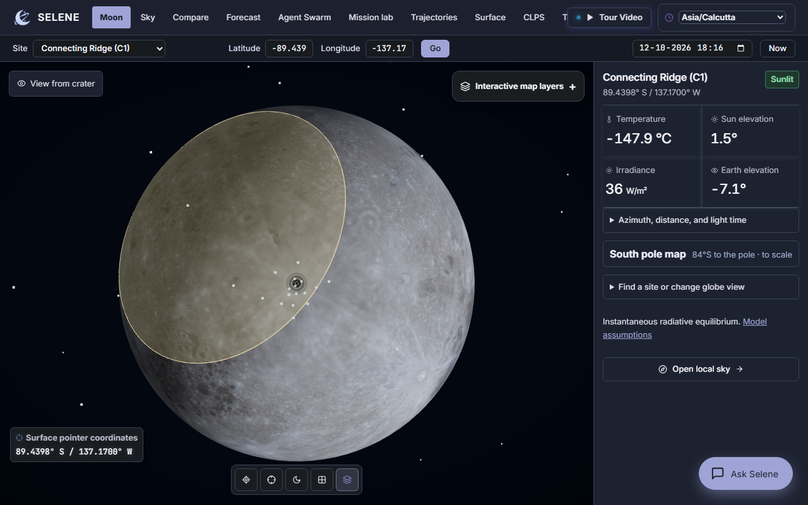

# Selene — Frontend

**Lunar Mission Planning Explorer · NASA International Space Apps Challenge 2026 · Bhopal**

The web interface for Selene: an interactive 3D Moon atlas, environmental forecasts, mission-operations screening, NASA data views and engineering calculators.



- **Live site:** https://selenenasa.netlify.app
- **Backend API:** [khalahuja/nsac_backend](https://github.com/khalahuja/nsac_backend)

> Selene is a research and educational prototype for preliminary planning. It is not a flight-certified mission-design or landing-safety system.

## Tech stack

| Area | Libraries |
|---|---|
| Framework | React 18, TypeScript, Vite 6 |
| 3D | three.js, React Three Fiber, drei |
| Charts | Recharts |
| Icons | Lucide React |
| Production serving | Netlify (static) or nginx (Docker) |

## Project structure

```text
src/
  components/     Application workspaces (atlas, forecasts, operations, NASA data, mission lab, chat)
  lib/            Browser-side calculations, API endpoints, navigation and time utilities
  services/       API clients
  types/          Shared TypeScript types
  *.css           Styles and design tokens
public/           Static assets: textures, guided-tour images, logo, robots.txt
tests/            Calculation and browser checks (see tests/README.md)
nginx.conf        Server config and security headers for the Docker image
Dockerfile        Two-stage build: Vite build, then nginx
```

## Run locally

**Prerequisites:** Node.js 22 and npm. Run the [backend](https://github.com/khalahuja/nsac_backend) on `http://127.0.0.1:8000` for API features.

```bash
npm ci
npm run dev
```

Open http://127.0.0.1:5173. In development, Vite proxies every `/api` request to `http://127.0.0.1:8000` (see `vite.config.ts`), so you don't need to set `VITE_API_BASE_URL`.

## Configuration

| Variable | When to set it | Example |
|---|---|---|
| `VITE_API_BASE_URL` | Production builds where the API is on a different origin | `https://nsac-backend.onrender.com` |

Vite reads this variable **at build time**, not at runtime. After you change it, rebuild the site. Leave it empty when the frontend and API share an origin, for example in Docker Compose or local development.

Keep secrets out of this repository. Anything prefixed `VITE_` ends up in the public JavaScript bundle. The chatbot's Groq key belongs on the backend only.

## Build

```bash
npm run build     # type-check, then build to dist/
npm run preview   # serve the production build locally
```

## Deploy

### Netlify

| Setting | Value |
|---|---|
| Base directory | *(empty)* |
| Build command | `npm run build` |
| Publish directory | `dist` |
| Environment variable | `VITE_API_BASE_URL=https://<your-backend-host>` |

After setting or changing `VITE_API_BASE_URL`, go to **Deploys → Trigger deploy → Deploy project without cache**.

On the backend, add the Netlify URL to `CORS_ORIGINS`, for example `https://selenenasa.netlify.app`. Otherwise the browser's requests are rejected.

### Docker

```bash
docker build -t selene-frontend --build-arg VITE_API_BASE_URL=https://<your-backend-host> .
docker run -p 5173:5173 selene-frontend
```

The image serves `dist/` with nginx on port 5173. It applies the security headers from `nginx.conf`, including a Content-Security-Policy. If the API runs on a different origin, add that origin to `connect-src` in `nginx.conf`.

## Tests

```bash
npm run test:chat-followups      # chat follow-up suggestion logic
node tests/mission.cjs           # mission maths
node tests/science.cjs           # numerical and terrain-import checks
node tests/operations.cjs        # surface-operations logic
node tests/nasa-data.cjs         # NASA data helpers
```

The `browser-*.cjs` scripts drive a headless Edge or Chromium and need a running dev server or preview build. See [tests/README.md](tests/README.md) for ports and prerequisites. They were written for the original combined repository layout, so some may expect paths from the parent `nsac/` folder.
